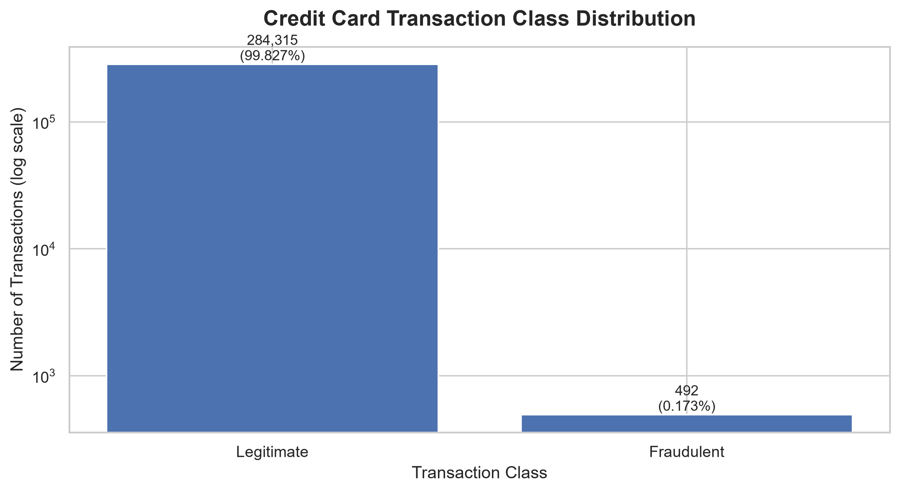
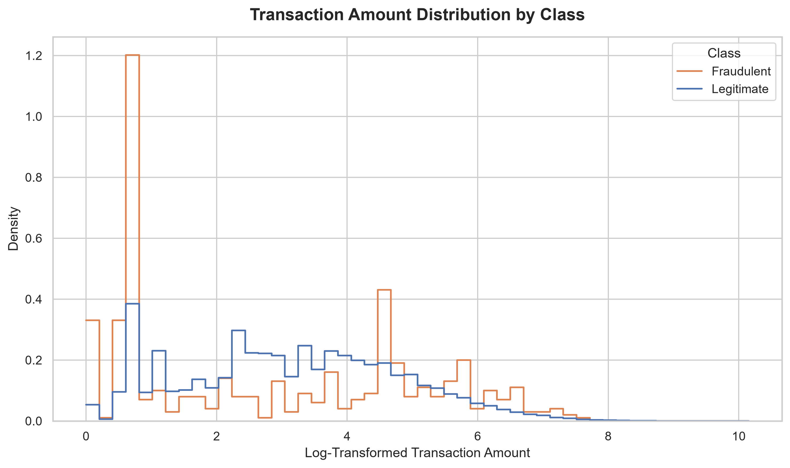
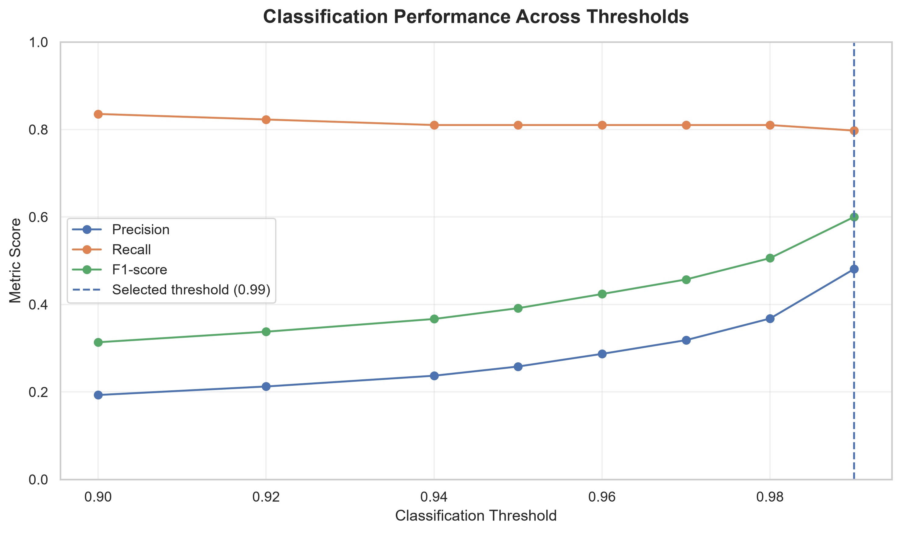
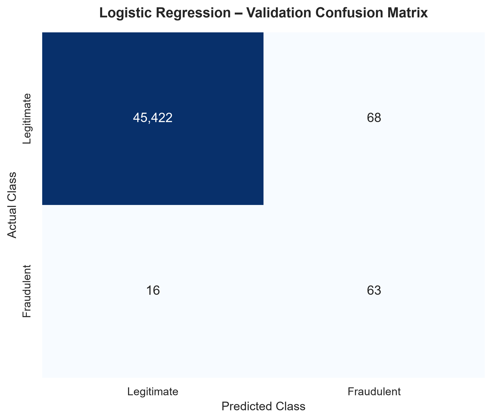

# Financial Fraud Detection System

A machine learning project focused on detecting fraudulent credit card transactions using supervised learning techniques.

The project covers the end-to-end data science workflow, including exploratory data analysis, feature engineering, model development, threshold optimization, and performance evaluation.

> **Project status:** In Progress  
> **Current milestone:** Exploratory Data Analysis and Logistic Regression baseline

## 1. Project Overview

Credit card fraud detection is a challenging classification problem due to the highly imbalanced nature of transaction data. Fraudulent transactions represent only a very small proportion of all transactions, making traditional accuracy-based evaluation insufficient.

The goal of this project is to develop machine learning models capable of identifying fraudulent transactions while balancing fraud detection performance and false positive rates.

## 2. Business Problem

Financial institutions need to identify suspicious transactions as accurately as possible.

Two types of prediction errors are particularly important:

- **False Negative:** A fraudulent transaction is classified as legitimate.
- **False Positive:** A legitimate transaction is incorrectly flagged as fraudulent.

The project evaluates models using metrics that reflect these challenges, with particular emphasis on Precision, Recall, F1-score, and Precision-Recall AUC.

## 3. Dataset

The project uses the Credit Card Fraud Detection dataset provided by the Machine Learning Group of Université Libre de Bruxelles (ULB).

**Source:** [Credit Card Fraud Detection – Kaggle](https://www.kaggle.com/datasets/mlg-ulb/creditcardfraud)

Dataset characteristics:

| Property | Value |
|---|---:|
| Total transactions | 284,807 |
| Features (original) | 30 |
| Target variable | Class |
| Legitimate transactions | 284,315 |
| Fraudulent transactions | 492 |
| Fraud percentage | 0.173% |

The dataset contains anonymized numerical features (`V1`–`V28`) obtained through Principal Component Analysis (PCA), together with transaction time and amount.

The target variable `Class` is defined as:

- `0` – Legitimate transaction
- `1` – Fraudulent transaction

**Note:** The dataset is not included in this repository. Download it from Kaggle and place `creditcard.csv` in `data/raw/`.

## 4. Project Structure

```text
financial-fraud-detection/
│
├── data/
│   ├── raw/
│   └── processed/
│
├── notebooks/
│   ├── 01_exploratory_analysis.ipynb
│   └── 02_model_training.ipynb
│
├── src/
│   ├── data/
│   ├── features/
│   ├── models/
│   ├── evaluation/
│   └── explainability/
│
├── tests/
├── reports/
├── app/
│
├── README.md
├── requirements.txt
└── .gitignore
```

## 5. Exploratory Data Analysis

The initial analysis focuses on understanding the dataset, assessing data quality, and investigating the distribution of fraudulent transactions.

Key findings:

- The dataset contains 284,807 transactions.
- No missing values were identified.
- The target variable is extremely imbalanced.
- Fraudulent transactions account for approximately 0.173% of all observations.

The imbalance makes it necessary to use evaluation metrics beyond accuracy.

### Class Distribution



### Transaction Amount Distribution



## 6. Feature Engineering

Two additional features were introduced:

| Feature | Description |
|---|---|
| `Hour` | Approximate 24-hour cycle derived from transaction time |
| `Log_Amount` | Logarithmic transformation of transaction amount |

The `Hour` feature is an experimental transformation of elapsed time, not a verified clock hour.

The transformed amount feature is intended to reduce the skewness of transaction amounts.

## 7. Machine Learning Approach

The project will investigate several classification algorithms:

- Logistic Regression
- Random Forest
- XGBoost
- Isolation Forest (exploratory unsupervised approach)

The initial baseline model is Logistic Regression.

A Scikit-learn Pipeline is used to combine feature scaling and model training, ensuring that the scaler is fitted only on training data.

The model uses class weighting to account for the imbalanced target variable.

## 8. Evaluation Strategy

The following evaluation metrics are used:

| Metric | Purpose |
|---|---|
| Precision | Measures how many predicted fraud cases are actually fraudulent |
| Recall | Measures how many actual fraud cases are detected |
| F1-score | Harmonic mean of Precision and Recall |
| PR-AUC | Evaluates the Precision-Recall trade-off |
| ROC-AUC | Measures ranking performance across classification thresholds |

Accuracy is not treated as the primary evaluation metric due to severe class imbalance.

The dataset is initially split using stratified sampling. Threshold selection is performed on a validation subset, while the test set is reserved for final evaluation.

## 9. Initial Results – Logistic Regression

The first Logistic Regression baseline was evaluated on the test set using the default classification threshold of 0.50.

| Metric | Result |
|---|---:|
| Precision (fraud) | 0.06 |
| Recall (fraud) | 0.91 |
| F1-score (fraud) | 0.11 |
| PR-AUC | 0.7241 |
| ROC-AUC | 0.9733 |

The model detected 89 out of 98 fraudulent transactions in the test set, but also generated 1,489 false positives.

This demonstrates that a high ROC-AUC does not necessarily translate into an operationally useful classification threshold.

### Threshold Optimization

A separate validation set was used to investigate the effect of classification threshold selection.

| Threshold | Precision | Recall | F1-score |
|---:|---:|---:|---:|
| 0.50 | 0.058 | 0.886 | 0.108 |
| 0.70 | 0.104 | 0.848 | 0.185 |
| 0.80 | 0.140 | 0.835 | 0.240 |
| 0.90 | 0.193 | 0.835 | 0.314 |
| 0.95 | 0.258 | 0.810 | 0.391 |
| 0.98 | 0.368 | 0.810 | 0.506 |
| 0.99 | 0.481 | 0.797 | 0.600 |

The threshold of 0.99 achieved the highest F1-score among the tested validation thresholds.

At this threshold, the validation results were:

- True Positives: 63
- False Positives: 68
- False Negatives: 16
- Precision: 48.1%
- Recall: 79.7%
- F1-score: 0.600

This represents a substantial improvement in the Precision-Recall balance compared with the default threshold.

**Important:** These threshold optimization results are from the validation set. Final test-set evaluation at the selected threshold is a separate step and is not yet reported.

### Threshold Optimization



### Validation Confusion Matrix



## 10. Limitations and Future Improvements

Current limitations:

- Severe class imbalance.
- Anonymized PCA features limit direct business interpretation.
- The initial random stratified split does not fully represent a chronological deployment scenario.
- The selected threshold requires further evaluation against operational costs.
- The Logistic Regression model is a baseline, not a production-ready fraud detection system.

Planned improvements:

1. Develop and evaluate Random Forest.
2. Implement XGBoost.
3. Compare models using Precision, Recall, F1-score, PR-AUC, and ROC-AUC.
4. Investigate threshold optimization and cost-sensitive evaluation.
5. Add model explainability using SHAP.
6. Develop a prediction API using FastAPI.
7. Build an interactive dashboard using Streamlit.
8. Add automated tests, Docker support, and CI/CD.

## 11. Installation and Usage

### Clone the repository

```bash
git clone https://github.com/magdalenachmaj/financial-fraud-detection.git
cd financial-fraud-detection
```

### Create a virtual environment

Windows PowerShell:

```powershell
py -m venv .venv
.venv\Scripts\Activate.ps1
```

### Install dependencies

```bash
pip install -r requirements.txt
```

### Download the dataset

Download the dataset from Kaggle and place the file here:

```text
data/raw/creditcard.csv
```

### Launch Jupyter Notebook

```bash
jupyter notebook
```

Open the notebooks in the following order:

1. `01_exploratory_analysis.ipynb`
2. `02_model_training.ipynb`

## 12. Technologies

- Python
- Pandas
- NumPy
- Matplotlib
- Seaborn
- Scikit-learn
- Jupyter Notebook
- Git and GitHub

## 13. Author

Developed as a portfolio project focused on practical machine learning, imbalanced classification, and financial fraud detection.

---

*This project is intended for educational and portfolio purposes. It is not a production financial fraud detection system.*
